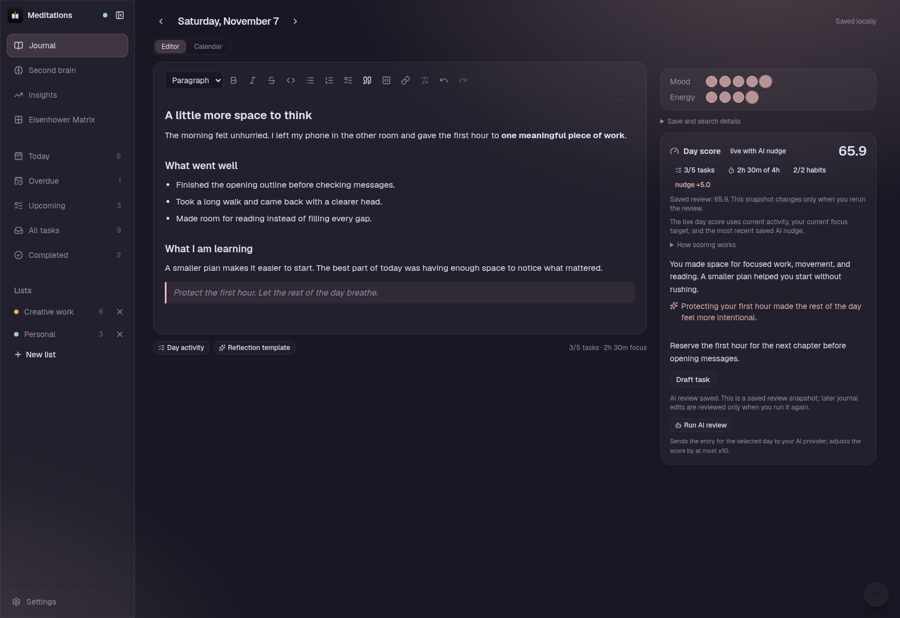
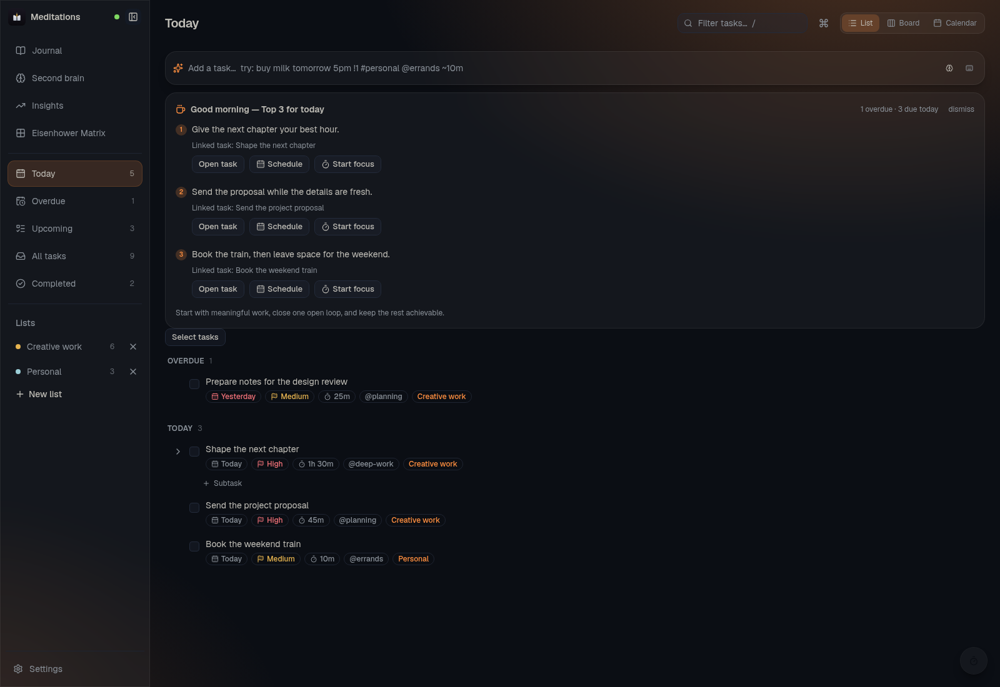
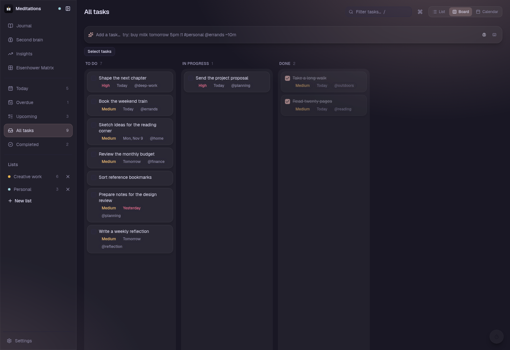
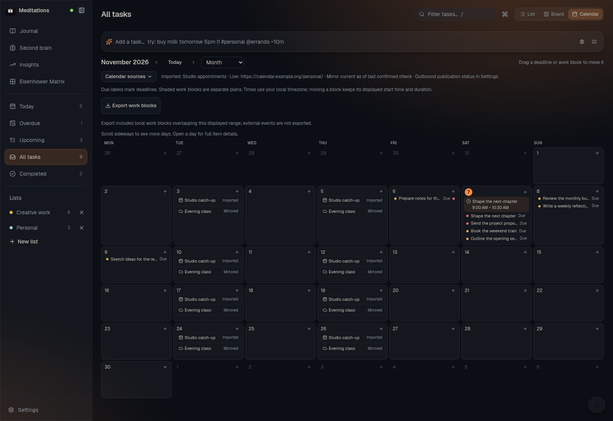
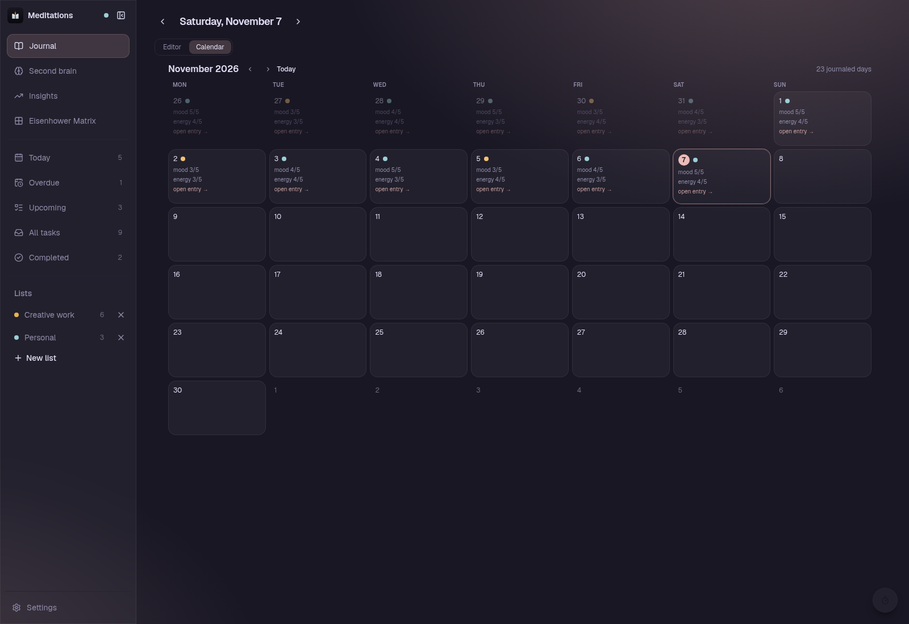
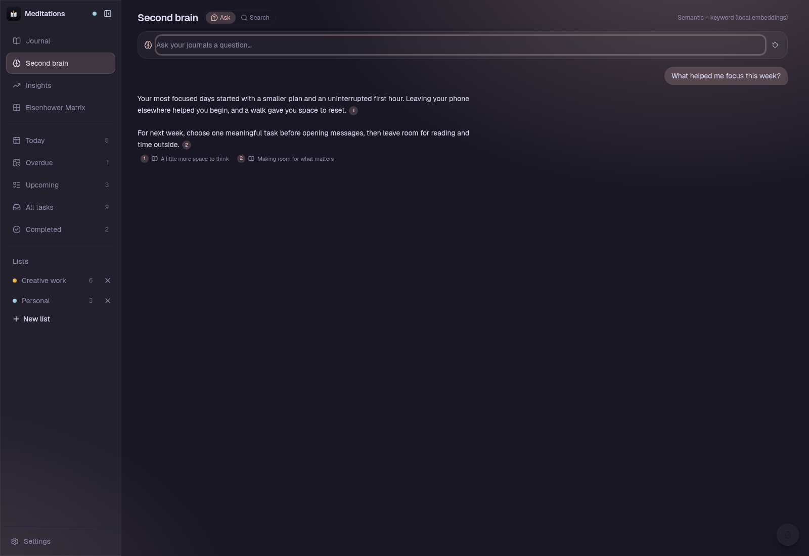
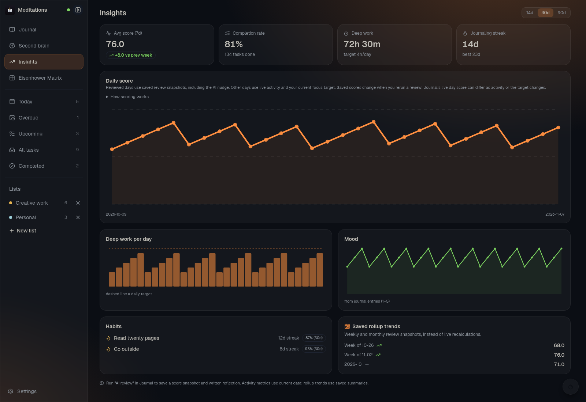

<p align="center">
  
</p>

# Meditations — local-first life-OS

A single local app that combines **TickTick-grade task management**, **reflective
journaling** (TipTap markdown), and a **hierarchical AI compaction system**
(PydanticAI). Everything runs on your machine: SQLite storage, local-first API,
optional AI against any OpenAI-compatible endpoint (defaults to a local Ollama).

<p align="center">
  
</p>


## Features

- **Quick-add capture** — natural-language parsing: `buy milk tomorrow 5pm !1 #personal @errands ~10m`
  with chrono-node dates, `!1/!2/!3` priorities, `#lists`, `@tags`, `~durations`,
  and `every mon, wed` recurrence (RRULE subset).
- **Task views** — list sections (Overdue / Today / Tomorrow / Upcoming / No date /
  Completed), Kanban board with drag-and-drop, subtasks, inline rename, and
  recurring-task clones on completion. Calendar includes Year, Month, Week,
  Agenda, Multi-Day, and Multi-Week. The independent Matrix section uses explicit
  importance and urgency instead of inferring them from priority or deadlines.
- **Journal** — one markdown entry per day with mood/energy ratings, tipTap editor,
  and a hard rule that a day is never auto-created empty.
- **Hybrid search** — SQLite FTS5 (keyword) + sqlite-vec (semantic embeddings via
  fastembed), with a distance cap so tiny indexes never over-match.
- **AI reviews** — daily / weekly / monthly compaction agents with strictly bounded
  context (the daily agent reads today + 6 past days + latest rollups; token cost
  is O(1) regardless of history), plus daily briefing, capture assists, and Q&A —
  with SSE for daily review, briefing, Q&A, and editor assists. Weekly/monthly
  reviews, capture, and decomposition use ordinary request responses.
- **Daily score** — deterministic and never LLM-computed:
  `0.40*task + 0.35*focus + 0.15*habit + clamp(llm_nudge, ±10)`; unconfigured
  components are neutral, never punitive.
- **Optional outgoing webhooks**: Send selected time-block changes and task completions to a trusted workflow endpoint. Event/list scopes, optional title sharing, signed requests, durable retries, and delivery status live in Settings. This is independent of calendar sync; see the [workflow guide and local example](docs/webhooks.md).
- **Desktop shell** — Tauri v2 with system tray (show/quit) and a
  `Super+Shift+A` global shortcut that focuses the app from anywhere.

## Screenshots

### Tasks — List View
Natural-language capture, AI daily briefing ("Good morning — Top 3 for today"), priority flags, duration badges, and grouped sections (Overdue, Today, Upcoming).

After a briefing finishes, linked recommendations offer **Open task**, **Schedule**
and **Start focus**. Scheduling creates a local work block and leaves the task's
deadline unchanged. If another focus session is in progress, finish or reset it
before switching tasks. General advice remains readable without a task link.

In Journal, a saved daily review's follow-up offers **Draft task**. Edit its title
and optional deadline, then choose **Create task** to confirm. Failed saves keep
the draft for retry; drafts stay within the current review view rather than being
saved automatically.



### Tasks — Kanban Board
Drag-and-drop task status workflow across To Do, In Progress, and Done, with integrated Pomodoro and Stopwatch focus timer.

Choose a list or smart view in the sidebar to filter Board, then narrow it with
Filter tasks. All tasks and custom lists keep their matching completed tasks in
Done. Today, Overdue, and Upcoming show active tasks; Completed shows Done only.
Board shows top-level tasks, with up to 30 matching Done cards and a count of older
completed tasks. Use List to work with subtasks.



### Organize several tasks

Choose **Select tasks** in List, Board, or Matrix, then select individual tasks or
use **Select all visible**. Selection checkboxes are separate from completion;
Tab and Space work with them. List reveals immediate subtasks so you can select
them independently. Board selects only displayed top-level cards, including up
to 30 matching Done cards. Changing the view, section, scope, or filter clears
selection. If you navigate during a batch, unsent changes stop; an update already
sent can still finish. Calendar remains outside bulk organization.

Assign a list, change status, or add/remove a tag, then choose **Review changes**
and confirm. Completing recurring tasks creates their successors using the usual
recurrence rules; the confirmation explains this instead of offering an undo.
Successful edits stay saved if another task fails. Review the named errors and
choose **Retry failed only** to confirm another attempt without repeating the
successful changes. Use **Done selecting** or Escape to leave selection mode.

### Tasks — Calendar View
Choose Year, Month, Week, Agenda, Multi-Day, or Multi-Week. Task deadlines and
work blocks stay separate: moving a work block leaves its task deadline unchanged.
Use **Calendar sources** to show imported or live appointments; setup stays in
Settings. The screenshot below shows Month.



### Reflective Journaling — Calendar & Mood History
Month overview of journal entries with mood and energy indicators to visualize consistency and emotional trajectory over time.

**Saved locally** confirms the journal database write. If saving fails, keep the
entry open and choose **Retry local save** to save the current text and ratings.
Open **Save and search details** to check keyword and semantic indexing separately;
**Retry indexing** rebuilds search from the saved entry. AI review progress is
shown beside the review controls, and streamed feedback remains a preview until
the review finishes. A saved review is a snapshot; rerun it after later edits.

Calendar publication has its own queue and acknowledgement in **Settings → Calendar
synchronization**. A current read-only mirror in **Calendar sources** describes the
last confirmed check, rather than confirming that local work blocks were published.



### Second Brain — Hybrid Search & AI Q&A
Natural-language Q&A and semantic search across personal journals combining SQLite FTS5 and sqlite-vec embeddings, with citations linked to source entries.

Q&A questions accept up to 4,000 Unicode code points, including surrounding whitespace. Longer questions receive a validation error so you can shorten them instead of having them silently truncated.



### Insights & Telemetry Dashboard
Telemetry dashboard featuring deterministic daily score trends, completion rates, deep work hours, mood charts, and habit streaks.

#### Score display

Choose **Settings → Appearance → Score display → Reflection-first** to hide
numeric scores, score charts and score trends in Journal and Insights. Mood,
energy, focus time, task/habit activity, written reflections and suggested actions
remain available. The preference is saved on this device. Reviews still run and
save scores; written reflections and search excerpts may still mention numbers.
Choose **Show scores** to restore the scoring displays.

Full task, focus and habit components contribute 40 + 35 + 15 = **90 points**
before the AI nudge. An AI review can add or subtract up to 10 points, with the
final score kept between 0 and 100. Open **How scoring works** in Journal or
Insights for the component rules.

Journal's day score recalculates from current activity and your current focus
target, including the latest saved AI nudge. Its separate saved review value is a
snapshot. Insights uses saved review scores for reviewed days and live calculations
for other days; weekly/monthly score trends use saved summaries. Rerun a review
to update its snapshot after activity or target changes.

Historical planned-task counts exclude tasks created after the report day ended
(midnight UTC), even when their deadlines are backdated. Live counts use current
task data, so later deadline edits, status changes, or deletions can still change
them; they are not a record of your original plan. Saved reviews stay unchanged
until you rerun them.

Journal and daily-habit streaks use your full history, regardless of the chart period.
Journal entries with text, a mood rating, or an energy rating count toward your streak.
A current streak can end today or yesterday; future dates are excluded.
Habit completion rates use the last 30 days, including today.



## Layout

For implemented architecture, see the [root reference](plan.md). For API and
recovery operations, see the [backend guide](backend/README.md).

```
backend/    FastAPI + SQLite (WAL) + FTS5 + sqlite-vec + PydanticAI agents
frontend/   React 19 + Vite + Tailwind v4 + shadcn v4/Base UI + TipTap v3 + Tauri v2 shell
systemd/    retirement script for legacy HTTP rollup timers
setup.sh    install backend + frontend dependencies (once per clone)
dev.sh      launch backend + frontend for development (see Quick start)
```

In development, the desktop shell uses a separately started backend at
`http://127.0.0.1:8000` (`./dev.sh` starts it alongside Vite). Packaged builds
start their bundled backend on a random loopback port; no separate server is needed.

## Install (Linux releases)

Prebuilt, self-contained bundles ship via [GitHub Releases](https://github.com/Aayushvaishnav02/Meditations/releases):

```bash
# Fedora / RHEL
sudo dnf install ./Meditations_*.rpm

# Debian / Ubuntu
sudo apt install ./Meditations_*.deb

# Any distro (needs libfuse2 — Fedora: sudo dnf install fuse)
chmod +x Meditations_*.AppImage && ./Meditations_*.AppImage
```

The backend ships inside the app (PyInstaller sidecar) — no Python required.
Data lives in `~/.local/share/dev.journal.app/journal.db`; set
`MEDITATIONS_LEGACY_DB=/path/to/backend/data/journal.db` before first launch
to import an existing dev database (stop the dev backend first — the import
is skipped while `-wal`/`-shm` sidecars exist). Semantic search works out of
the box; the embedding model (~100 MB) downloads to `~/.cache` on first use.

## Quick start (dev)

Prerequisites: [uv](https://docs.astral.sh/uv/) (it fetches Python 3.12 itself)
and Node **20.19+ or 22.12+** (required by Vite 8). Nothing else.

```bash
git clone <repo> && cd Journal
./setup.sh   # once per clone — installs backend (.venv via uv sync) + frontend (npm install)
./dev.sh     # backend :8000 + frontend :5173; Ctrl-C stops both
```

`dev.sh` refuses to start over an occupied port instead of letting Vite drift
ports. Inspect the owning process and stop the intended development instance, or
choose another pair with `BACKEND_PORT=8001 FRONTEND_PORT=5174 ./dev.sh`. Flags:
`--backend` / `--frontend` for a single service. The Tauri development shell still
expects backend port 8000. The SQLite
DB (`backend/data/journal.db`) and its schema are created on first backend
start.

Re-run `./setup.sh` any time `uv.lock` / `package-lock.json` change — both
installers are idempotent.

Manual equivalent:

```bash
# Run each command from the repository root in a separate terminal.
# 1. backend, API on :8000
(cd backend && uv sync --locked && uv run uvicorn app.main:app --reload)

# 2. frontend, UI on :5173
(cd frontend && npm ci && npm run dev)
```

Optional AI: point the app at any OpenAI-compatible endpoint (defaults to local
Ollama) — via `backend/.env` or the in-app Settings. There are two model tiers:
a **main model** (reviews, decomposition) and a **fast tier** (capture, briefing,
Q&A, assists) that falls back to the main model. Per-agent prompt overrides live
in `app_settings`. Details in `backend/README.md`.

## Database backups

Open **Settings → Database backup → Save backup**. On desktop, choose a new
`.db` filename in the save dialog; existing files are preserved. In the browser,
the file goes through the browser's download manager. Keep Settings open until
the snapshot is ready, then check that the file was saved.

The app can stay open during backup. The snapshot includes committed tasks,
journals and ratings, reviews, habits, focus history, settings, and related
records, including data still in SQLite's WAL. Unsaved editor changes are outside
the snapshot; finish saving them first. Do not copy only the live `journal.db`
file while the app is running.

**Treat backups as sensitive.** They are unencrypted and include private journal
content and API keys saved in Settings. Environment files and the downloaded
embedding model are separate from the database and are excluded. Keep backups in
a private location, with encryption when appropriate. CalDAV credentials use the
OS credential store instead of SQLite and are excluded from backups. Enter them
again when moving the database to another path or machine; verify calendar
connections explicitly after restart or restore. Optional calendar setup and per-block synchronization controls are available in
**Settings → Calendar synchronization**; see the
[calendar synchronization guide](docs/calendar-sync.md).

For local `.ics` files, use **Settings → Import calendar files**. Imports retain
external appointments and recurring series in a read-only inventory, separate
from tasks, work blocks and scores. Reimport into the same destination to update
matching event identities; omitted records remain. In Calendar, choose an
**Imported calendar** inside **Calendar sources** to show appointments and supported
recurring occurrences as a read-only overlay across all six calendar modes.
Unsupported series appear under **Outside the grid**. Reminders remain deferred. See the
[calendar import guide](docs/calendar-import.md).

For a connected CalDAV calendar, select **Live calendar** inside **Calendar sources** to show
read-only mirrored appointments. Verify and enable the connection in Settings
first. Last-check and stale-cache messages distinguish mirrored snapshots from
current server availability; remote events never rewrite local tasks. See
[mirroring remote events](docs/calendar-sync.md#mirror-remote-events-read-only).

Automatic ICS URL subscriptions and Journal-hosted feeds are unavailable. The
[subscription evaluation](docs/calendar-subscriptions.md) distinguishes future
external URL polling from publishing a reachable, access-controlled Journal feed.
Both would be one-way, with refresh timing controlled by the consuming client.

Default database locations:

| Runtime | Location |
|---|---|
| Packaged Linux desktop | `~/.local/share/dev.journal.app/journal.db` (under `$XDG_DATA_HOME` when set) |
| Development backend started from `backend/` | `backend/data/journal.db` |
| Standalone backend override | `JOURNAL_DB_PATH`; relative paths resolve from the backend process's working directory |

Backups are snapshots, not live synchronization or portable Markdown/JSON exports.

### Restore a backup

1. Finish saving your work, then exit Meditations using **Quit** in the tray
   menu or by closing its main window. The current shell requests sidecar cleanup
   on exit; confirm no backend still owns the target database. Stop standalone
   backends using that database too.
2. From a source checkout, run the following from `backend/`, using the database
   location from the table above. Both paths are explicit; no running API is used.

   ```bash
   uv run python -m app.recovery restore /path/to/backup.db --database /path/to/journal.db
   ```

   An installed packaged backend supports the same arguments:
   `meditations-backend restore /path/to/backup.db --database /path/to/journal.db`.
   Use the backend executable inside the application's bundled resources, not
   the desktop launcher.
3. Check the success message and the printed recovery-checkpoint path, then restart
   the app. Search indexes reconcile automatically on startup. Semantic search can
   remain pending while its embedding model is unavailable; text search still works.

Restore checks integrity, relationships, and schema compatibility on a temporary
copy and upgrades that copy when needed. An incompatible or newer backup is
rejected without replacing your database. Before replacement, the current
committed database is saved in a private `recovery/` directory beside it. If you
need to undo a restore, quit the app and restore that checkpoint with the same
command. If replacement fails, keep the reported files and resolve the cause
before retrying. Restore replaces settings and saved API keys as well as content.

Existing databases also get a recovery checkpoint before any pending schema
upgrade. A checkpoint failure prevents the upgrade; a failed migration rolls back
and leaves the checkpoint available. Check backend logs for its path. Fresh
installs and starts with an up-to-date schema do not create checkpoints. These
unencrypted files are kept until you remove them; protect them like backups and
check disk space before upgrades.

The ownership lock prevents restore while an updated Journal backend is running.
It is advisory: quit older app versions and all external SQLite tools yourself.
Do not delete the `.lock` file to bypass a lock or manually remove WAL files.
Restore is an offline command; there is no restore button in Settings.

Release testers can use the [packaged desktop acceptance procedure](docs/desktop-acceptance.md)
for disposable-profile startup, native backup dialogs, offline recovery, and
isolated calendar credential checks. It distinguishes native UI acceptance from
frozen-backend smoke coverage.

## Portable data export

Open **Settings → Portable data export → Export data (.zip)** to save readable
copies of your data. The app can stay open. On desktop, choose a new filename;
in a browser, check your downloads when the export is ready. Finish saving editor
changes first: exports include committed data across all dates and lists, from
one consistent snapshot.

The ZIP contains:

- `journals/YYYY-MM-DD.md`: your saved Markdown unchanged, including existing
  frontmatter. Entries with ratings only have an empty Markdown file.
- `data.json`: journal metadata and ratings, lists, tasks and subtasks, focus
  sessions, habits and logs, and saved daily/weekly/monthly reviews.
- `manifest.json`: format version, export time, and record counts.
- `README.md`: field guide, date/time rules, and relationships for other tools.

Original IDs, relationships, statuses, tags, scheduling values, and recurrence
identity are preserved. Timestamps explicitly use UTC (`Z`); calendar date labels
stay dates. Reviews remain saved snapshots instead of being recalculated during
export.

Application settings and provider credentials saved in Settings are excluded,
along with AI usage, review jobs, and search indexes. Your text is copied without
redaction, so anything private you wrote into tasks or journals is still included.
**The ZIP is unencrypted. Review its contents before sharing it.**

Use **Database backup** for application recovery. Portable ZIP import is not
available; these files are for reading, keeping, and using with other tools.

## Scheduled AI rollups

Packaged Meditations reviews completed UTC days, weeks, and months while the
app is open, with catch-up on restart. Standalone/development backends opt in
with `JOURNAL_SCHEDULED_REVIEWS=true`. See [scheduling details](backend/README.md#scheduled-rollups)
for period boundaries, retry behavior, and first-run costs.

If you installed the previous systemd timers, remove their installed copies:

```bash
./systemd/install.sh   # retires the legacy port-8000 timers
```

## Desktop app (Tauri v2)

`npm run tauri dev` / `npm run tauri build` need the PyInstaller sidecar built
first — `./build-sidecar.sh` (CI builds it automatically). In dev the sidecar
is not spawned and the app talks to `./dev.sh`'s backend on :8000; packaged
builds spawn it on a free loopback port with the DB in
`~/.local/share/dev.journal.app/journal.db`.

### With a native toolchain (recommended)

Install the prerequisites, then build from `frontend/`. The desktop shell
requires **Rust 1.90 or newer**, including the native save-dialog/filesystem
plugins used by database backups:

```bash
# Fedora
sudo dnf install rust cargo webkit2gtk4.1-devel libappindicator-gtk3-devel \
                 libdbusmenu-gtk3-devel librsvg2-devel gcc gcc-c++
# Arch / EndeavourOS
sudo pacman -S --needed rust webkit2gtk-4.1 gtk3 base-devel
# Debian / Ubuntu
sudo apt install libwebkit2gtk-4.1-dev build-essential curl wget file
```

```bash
cd frontend
npm run tauri dev     # desktop app with tray + Super+Shift+A quick-add focus
npm run tauri build   # appimage/deb/rpm in src-tauri/target/release/bundle/
```

### Without root — vendored sysroot

Sandboxes, containers, or WSL images without sudo can vendor the whole
toolchain into the repo (no system changes). The two scripts are tracked in
`.tauri-sysroot/`:

```bash
# 1. vendor rustup + the webkit RPM dependency chain into .tauri-sysroot/
mkdir -p .tauri-sysroot/rpms && (cd .tauri-sysroot/rpms \
  && dnf download --resolve --alldeps webkit2gtk4.1-devel \
       libappindicator-gtk3-devel libdbusmenu-gtk3-devel librsvg2-devel)
export RUSTUP_HOME="$PWD/.tauri-sysroot/rustup" CARGO_HOME="$PWD/.tauri-sysroot/cargo"
curl --proto '=https' --tlsv1.2 -sSf https://sh.rustup.rs \
  | sh -s -- -y --profile minimal --no-modify-path
bash .tauri-sysroot/extract.sh          # extract RPMs, repoint pkg-config files

# 2. build (deb + rpm)
export PATH="$PWD/.tauri-sysroot/cargo/bin:$PATH" \
       PKG_CONFIG_PATH="$PWD/.tauri-sysroot/root/usr/lib64/pkgconfig:$PWD/.tauri-sysroot/root/usr/share/pkgconfig"
cd frontend && npm run tauri build -- --bundles deb,rpm

# 3. AppImage: an appimage bundle attempt prepares the AppDir, then fails at
#    linuxdeploy (expected — it can't see the vendored libs); finish with:
(cd frontend && npm run tauri build -- --bundles appimage) || true
bash .tauri-sysroot/build-appimage.sh
```

Fast local Rust check against the vendored sysroot (seconds, no CI round-trip;
tauri-build requires the resources path to exist, hence the stub):

```bash
mkdir -p frontend/src-tauri/binaries/meditations-backend \
  && touch frontend/src-tauri/binaries/meditations-backend/meditations-backend
cd frontend/src-tauri
CARGO_HOME=$PWD/../../.tauri-sysroot/cargo \
PKG_CONFIG_PATH="$PWD/../../.tauri-sysroot/root/usr/lib64/pkgconfig:$PWD/../../.tauri-sysroot/root/usr/share/pkgconfig" \
PATH="$PWD/../../.tauri-sysroot/root/usr/bin:$PATH" cargo check
```

Gotchas baked into this flow (see `AGENTS.md` for the full list):

- the Tauri bundler resolves `libappindicator` via pkg-config even for deb/rpm
  targets — keep `appindicator3-0.1` + `dbusmenu-glib-0.4` pc files reachable;
- tauri's pinned linuxdeploy bundles an outdated `strip` that rejects modern
  `.relr.dyn` sections — `build-appimage.sh` uses a current linuxdeploy build
  and pre-populates the AppDir because linuxdeploy cannot see non-system libs.

## Testing

Run from the repository root:

```bash
(cd backend && uv run pytest)
(cd frontend && npm run test)
(cd frontend && npm run build)
(cd frontend && npm run lint)
```

Endpoint tests use in-memory SQLite. Migration, backup, restore, locking, and WAL
tests also use isolated temporary files; they do not open your journal database.

### Pull-request and branch CI

`.github/workflows/ci.yml` runs on every branch push and pull request, and
supports manual runs. Five independent checks use Ubuntu 24.04: **Backend tests**
(Python 3.12, `uv sync --locked`) and **Frontend test**, **Frontend build**,
**Frontend lint**, and **Frontend timezones** (Node 24, `npm ci`). Failed frontend
checks do not cancel the other checks. Lint errors fail the lint check.

**Frontend timezones** runs `npm run test:timezones` in UTC, Asia/Kolkata,
America/New_York, Pacific/Kiritimati, America/Sao_Paulo, Pacific/Apia, and
Australia/Lord_Howe. It covers calendar ranges, projections, time grids, time
edits, and mode switching, including Year and Multi-Week. A failing zone stops
the runner and fails the check. Dedicated runner tests also verify nonzero exits,
signal termination, and process-start errors. Run the same checks locally:

```bash
cd frontend
node --test scripts/test-timezones.node-test.mjs
npm run test:timezones
```

To block merges, a repository administrator must enable a branch ruleset or
branch protection for the target branch and require all five check names above.
Select the checks after their first GitHub run. The workflow alone cannot enforce
merge protection. No path filters skip required checks; release tags use the
separate release workflow.

### Release validation

`.github/workflows/release.yml` calls the same five checks for each release tag
and manual build. The Linux bundle job waits for all of them to pass. It builds
the backend with Python 3.12 and the lockfile's `packaging` dependency group,
then launches that frozen executable through `backend/scripts/smoke_sidecar.py`.
A startup, health, or local CRUD failure stops the job before Tauri builds or
any draft-release creation or asset upload. The job also requires isolated
Radicale interoperability tests and authenticated discovery through that same
frozen executable; native vault access and the full desktop sync flow are not
covered. See [developer verification](docs/calendar-sync.md#developer-verification)
for the optional local-server suite. Manual runs validate and build
artifacts without creating a release.

To test an existing sidecar locally:

```bash
python3 backend/scripts/smoke_sidecar.py frontend/src-tauri/binaries/meditations-backend/meditations-backend
```

The smoke test uses a temporary working directory, database, and home/cache
paths. It disables scheduled reviews and model downloads, uses an ephemeral
loopback port, and cleans up its child process and temporary data. It does not
exercise AI providers or the desktop GUI. As with any draft release, publication
is a separate administrator action; the workflow cannot prevent manual uploads
or publication of an older draft.


Agent tests never touch the network (runners are monkeypatched / `TestModel`),
and the semantic-search tests stub `embed_texts` — no real fastembed model.

## Data contracts (the short version)

- **Datetimes are naive UTC everywhere** — SQLite drops offsets on read; the
  backend normalizes on write (`app/util.py`), the frontend parses with
  `parseUTC()` and sends `toISOString()`.
- **Scores are deterministic** (`backend/app/scoring.py`) — LLMs never compute
  scores or trends, they only contribute a clamped nudge.
- **AI context is bounded** — daily reads 7 days + latest rollups, weekly reads
  only daily scores, monthly only weekly rollups.
- **Journal entries must carry content, mood, or energy** — the API refuses
  fully empty saves and deletes emptied entries; visiting a day never creates
  one.
- **One tasks cache** (`["tasks"]` in `frontend/src/hooks/api.ts`) — grouping and
  filtering happen client-side; every mutation is optimistic with rollback.
